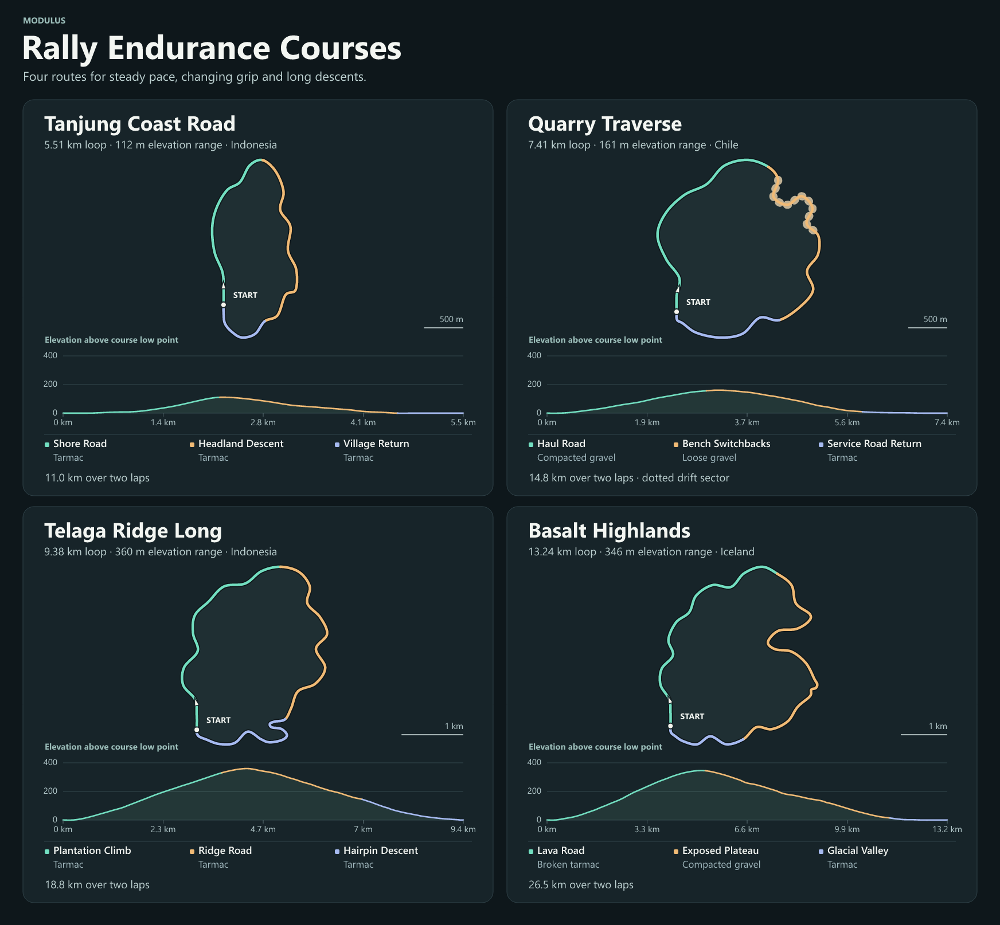

# Modulus rally endurance courses

Four fictional closed-road routes designed for a rally-oriented car game. Each loop links three named sections and works as a one-lap shakedown or a two-lap club event. The goal is to learn the road, carry a steady pace and manage the car through longer changes in grip and elevation.

| Course | One lap | Two laps | Elevation range | Steepest grade | Main challenge |
| --- | ---: | ---: | ---: | ---: | --- |
| [Tanjung Coast Road](routes/tanjung-coast.json) | 5.51 km | 11.0 km | 112 m | 11.9% | Brake before the headland descent and settle the car for the village bends. |
| [Quarry Traverse](routes/quarry-traverse.json) | 7.41 km | 14.8 km | 161 m | 9.6% | Carry speed through the gravel benches and adapt when grip returns. |
| [Telaga Ridge Long](routes/telaga-ridge-long.json) | 9.38 km | 18.8 km | 360 m | 16.4% | Preserve the brakes for the hairpins after a sustained climb. |
| [Basalt Highlands](routes/basalt-highlands.json) | 13.24 km | 26.5 km | 346 m | 11.5% | Pace the exposed plateau so the car stays composed on the return. |

Distances follow the three-dimensional centreline. Elevation range measures the highest point above the lowest point. The same 0–400 m vertical scale is used on all four charts.

## Course notes

### Tanjung Coast Road

The first rally-endurance route to introduce. Start on a flat shore road with broad sight lines, climb through gentle bends, then crest into the headland descent. Put braking markers before the first tightening turns after the crest. The final village bends reward a calm approach and good exit placement. Run dry tarmac for the shakedown and offer a light coastal shower for the club event.

### Quarry Traverse

Use compacted gravel from the line, loose gravel on the upper bench, and tarmac on the service-road return. The surface boundaries are waypoints 10 and 22, counted from zero. Give waypoints 11–17 a **Drift** session with clipping zones and space to recover outside the main line. Time Trial runs through the same section as part of a full lap. Use different scoring for the drift session. A wider, heavier pickup should feel at home here while still having to brake early for the descent.

### Telaga Ridge Long

Long enough to expose gearing and cooling choices. The plantation climb runs into a narrower ridge road and a blind crest. The last sector gathers several downhill turns into a linked hairpin section. Place clear brake markers before the steepest grades and leave sight lines into the tightest turn. A clean line through the descent should matter more to the run than a fast stretch at the top.

### Basalt Highlands

The longest course. Begin on broken tarmac, double back around a ridge on the compacted-gravel plateau, then return to tarmac through the glacial valley. The surface boundaries are waypoints 14 and 34, counted from zero. A dry or cold start suits an ordinary two-lap event. Optional sleet and service add a harder Royal Prix variant once changing grip and pits are available. A service spur should sit off the timed line near the valley return.

## Handoff to Antigravity

- The four JSON files use the current `ITrackSplineSchema`. They contain coordinates in metres, banking, widths, two timing split fractions and environment defaults. The split fractions are spline parameters. The lap targets and rewards are provisional values for the existing schema and need tuning after test drives.
- The map and elevation sheet came from the same spline as the route files. Validation checked the centreline and both road edges for self-crossings, built the existing road and wall collision meshes and checked finite geometry and spawn transforms for all four courses.
- **Terrain clearance needs work before catalog integration.** The current terrain apron intruded above the centreline in sampled sections of all four builds, with the largest intersections on the two mountain courses. The fixed 480-sample mesh also leaves intervals as wide as **37.7 m** on Basalt Highlands. Use distance- or curvature-based sampling and a road-clearance corridor for the terrain, then confirm clean sight lines and continuous contact at crests, hairpins and road edges.
- The surface, weather, service and drift notes describe the intended gameplay. The current route schema carries geometry and environment defaults. Add versioned sector attributes when integrating those mechanics. Run a complete starter-car lap on each course before setting medal times and enabling official records.

Bring up **Tanjung Coast Road** first to validate the longer-route pipeline, then **Telaga Ridge Long** to test sustained climbing, braking and terrain clearance. Quarry Traverse is the first mixed-surface and drift test. Basalt Highlands is the final endurance check.
