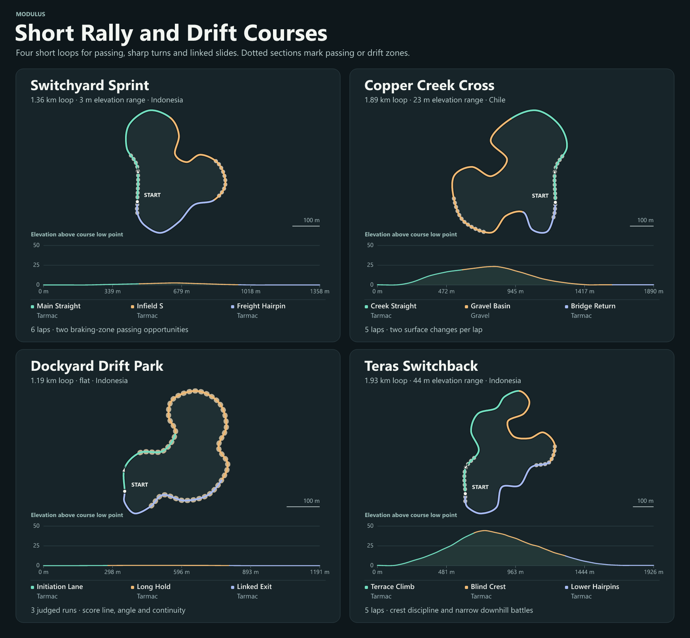

# Modulus short rally and drift courses

Four fictional circuits for repeatable lap battles, mixed-grip driving and short drift sessions. Each layout has sharp bends in both directions. The [rally endurance pack](../rally-endurance/README.md) covers longer roads, with Basalt Highlands as the feature event at **26.5 km over two laps**.

| Course | Lap distance | Elevation range | Suggested event | Best moment |
| --- | ---: | ---: | --- | --- |
| [Switchyard Sprint](routes/switchyard-sprint.json) | 1.36 km | 3 m | 6-lap club race | Show the nose into one braking zone, then look for a switchback pass when the direction changes. |
| [Copper Creek Cross](routes/copper-creek-cross.json) | 1.89 km | 23 m | 5-lap rallycross | Choose whether to attack on tarmac or save the tires and make the pass on gravel. |
| [Dockyard Drift Park](routes/dockyard-drift-park.json) | 1.19 km | Under 1 m | 3 judged drift runs | Hold a long slide, then link it through the next change of direction. |
| [Teras Switchback](routes/teras-switchback.json) | 1.93 km | 44 m | 5-lap technical race | Brake before the crest, then stay close through the descent and pass where the road widens. |

Distances follow the three-dimensional centreline. Dotted sections mark proposed passing or judged drift zones. All elevation plots use the same 0–50 m scale above the lowest point on each course.

## Course notes

### Switchyard Sprint

Use this as the first close-racing test. The main straight doubles as the first passing approach. The mid-lap left-right complex gives the driver on the outside a way to come back at the next apex. The road widens again before the tight freight-side bend. Put timing and feedback on clean exits since the next lap begins with the payoff from the final corner.

### Copper Creek Cross

Start with paved traction, enter a gravel basin through linked bends, then return to tarmac. The proposed changes are at waypoints 5 and 15, counted from zero. The paved start and the wider sweep out of the basin give two distinct chances to pass. Give the player a readable surface transition before the braking decision and scope the first event to a fixed dry surface.

### Dockyard Drift Park

Use the **Drift** tag and separate score from lap time. The judged span runs from waypoints 2 to 16. Give players a wide initiation lane, a long outer arc and a sequence of left-right changes. The final approach before the line is a reset area. Test solo runs on this layout first. Ghost tandem runs can later teach how to match a line without contact.

### Teras Switchback

Use the climb to spread cars out and the change in road width to bring them back together. The safer passing pockets are the main straight and the wider approach to the lower section. The crest and tight descent reward staying close enough to force a mistake and preparing the next exit. Keep brake markers readable before drivers enter the blind section.

## Handoff to Antigravity

- The route files use the existing `ITrackSplineSchema`. They carry centreline geometry, banking, widths, environment defaults and timing splits. The split fractions are spline parameters. The medal times and credit numbers are provisional.
- Passing zones, sector surfaces and drift scoring are design notes. The authoring preview shows their intended placement. Wire them into the versioned track format when those systems are ready.
- All four generated finite road and wall meshes and spawn transforms in the current builder. The centreline, road edges and runoff boundaries passed sampled self-crossing checks. The sampled terrain apron stayed below the centreline on all four layouts. Clearance across the full visible road and complete test laps still need browser verification.
- Start with **Switchyard Sprint** for player-versus-player or AI race spacing and **Dockyard Drift Park** for controlled slides. Add surface changes in **Copper Creek Cross**, then test crest visibility, recovery and downhill braking in **Teras Switchback**.
